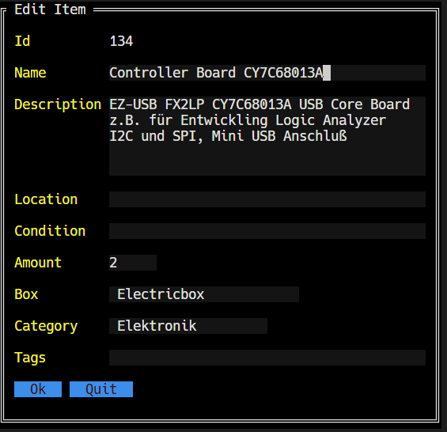
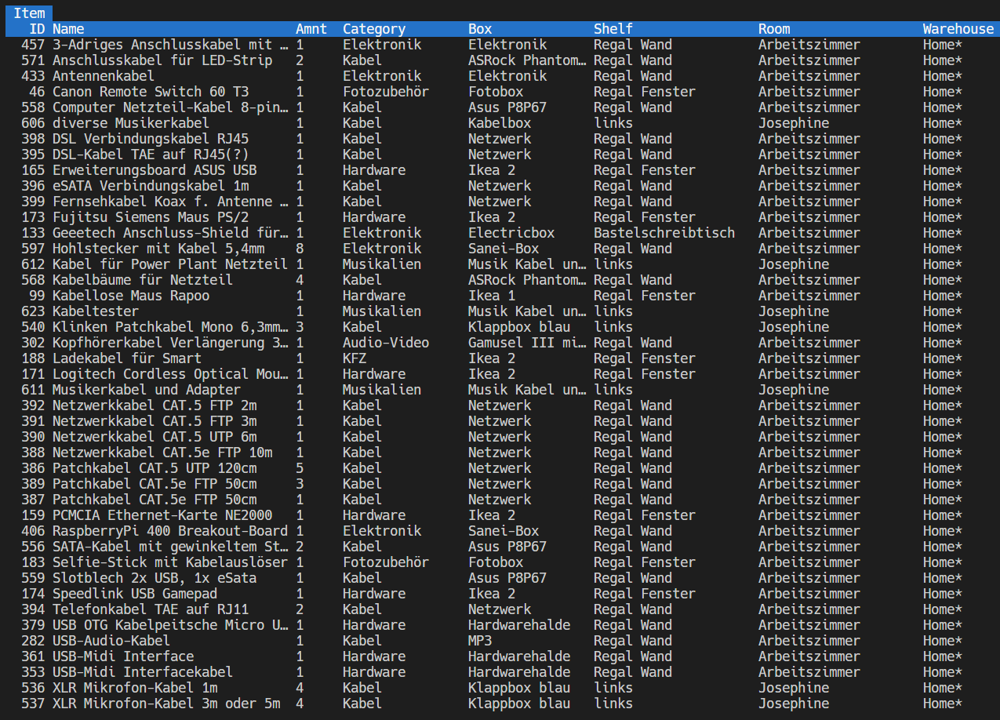
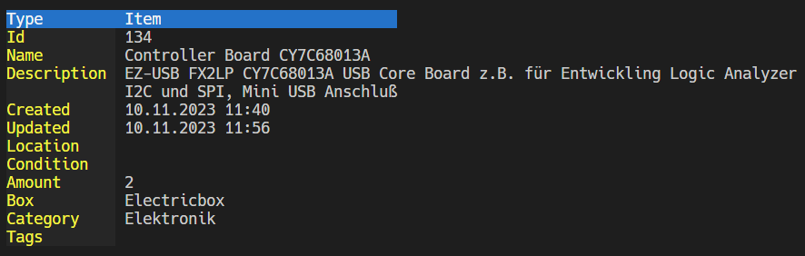

# Lagerator

Terminal-based personal inventory management in Go.

`Lagerator` keeps your stuff organized in a hierarchy:
Warehouse -> Room -> Shelf -> Box -> Item.
Items can also be assigned to categories and tagged.

## Features
- Hierarchical inventory structure (Warehouse/Room/Shelf/Box/Item)
- Categories and tags
- Text search across items
- TUI editor for adding/editing entries

## Installation

### Requirements
- Go 1.26.0+

### Build from source
```
git clone https://github.com/elsni/lagerator.git
cd lagerator
make build
```

The binary is created at `bin/lgrt`.

### Install to /usr/local/bin
```
make install
```

### Migrate data from ginventory

`make install` installs only the executable; it does not import inventory data.
The ginventory JSON format is compatible with Lagerator. To use the data file
from a sibling checkout, close both applications and run:

```sh
mkdir -p ~/.lgrt
# If Lagerator already has data, back it up before replacing it.
cp ../ginventory/ginvdata.json ~/.lgrt/lgrtdata.json
lgrt lw
lgrt li
```

This is a one-time copy; the original ginventory file remains unchanged.

## Usage

Run:
```
lgrt <operation> [args]
```

Show version/author:
```
lgrt --version
```

Build with version metadata:
```
make build VERSION=0.1.0
```

### Getting started (empty database)
When starting with an empty database, create the hierarchy top‑down:
1) Create a warehouse
2) Switch to it
3) Add rooms, shelves, boxes
4) Add items to a box (interactive)

Example (minimal workflow):
```bash
# add warehouse "Home"
lgrt aw Home

# switch to warehouse "Home"
lgrt sww Home

# add room "Basement"
lgrt ar Basement

# add a shelf to room (you need quotes only when name contains spaces)
lgrt as "Shelf A" Basement

# add box to shelf
lgrt ab "Box 1" "Shelf A"

# add items to box interactively
lgrt ai "Box 1"
```

Example (with categories + tags):
```bash
# add a category
lgrt ac "Tools"

# category can be selected in add-item dialog
lgrt ai "Box 1"

# add a tag to an item
lgrt at "fragile" <itemId>
```

Examples list and find:
```bash

# list all warehouses
lgrt lw

# list all rooms
lgrt lr

# list all shelves
lgrt ls

# list all boxes
lgrt lb

# list all items
lgrt li

# find all items containing "camera" in name or description
lgrt f camera

# find and sort result list
lgrt fs camera

# list items by tag
lgrt lit broken

# list items by category
lgrt lic clothing
```

Examples reorganizing items
```bash
# move item to different  box
lgrt mi <itemId> <box name|id>

# move box to different shelf
lgrt mb <boxId> <shelf name|id>
```

### Command reference

Run `lgrt` without arguments for built-in help. The table below also includes
commands currently omitted from that help. `name-or-id` resolves a matching
name first, then a numeric ID; ambiguous names open a selection dialog for
operations that need one record. Typed detail commands print all name matches.

| Command | Arguments | Function |
| --- | --- | --- |
| `version`, `--version`, `-v` | none | Show version, build metadata, and author |
| `aw` | `name` | Create warehouse |
| `sww` | `name` | Select active warehouse by exact name |
| `ar` | `name` | Create room in active warehouse |
| `as` | `name room-name-or-id` | Create shelf in selected room |
| `ab` | `name shelf-name-or-id` | Create box on selected shelf |
| `ai` | `box-name-or-id` | Add items repeatedly through the editor |
| `ac` | `name` | Create category |
| `lw`, `lws` | none | List warehouses; second command sorts by name |
| `lr`, `lrs` | none | List rooms; second sorts by name |
| `ls`, `lss` | none | List shelves; second sorts by name |
| `lb`, `lbs` | none | List boxes; second sorts by name |
| `li`, `lis` | none | List items; second sorts by name |
| `lc`, `lcs` | none | List categories; second sorts by name |
| `lt` | none | List tags sorted by name, with usage counts |
| `lic`, `lics` | `category-name-or-id` | List category items; second sorts by name |
| `lib`, `libs` | `box-name-or-id` | List box items; second sorts by name |
| `lit`, `lits` | `tag-name-or-id` | List tagged items; second sorts by name |
| `f`, `fs` | `text` | Search items; second sorts by name |
| `e` | `id` | Edit category, warehouse, room, shelf, box, or item |
| `ec`, `ew`, `er`, `es`, `eb`, `ei` | `name-or-id` | Edit the corresponding record type |
| `d` | `id` | Confirm deletion of category, warehouse, room, shelf, box, or item |
| `dc`, `dw`, `dr`, `ds`, `db`, `di`, `dt` | `name-or-id` | Confirm deletion of the corresponding type, including tags |
| `s` | `id` | Show category, warehouse, room, shelf, box, or item details |
| `sc`, `sw`, `sr`, `ss`, `sb`, `si` | `name-or-id` | Show details for the corresponding type |
| `at` | `tag-name object-id` | Attach a tag, creating it on first use |
| `rt` | `tag-name object-id` | Remove a tag from one object |
| `mi` | `item-id box-name-or-id` | Move item to box |
| `mb` | `box-id shelf-name-or-id` | Move box to shelf |

Lists span all warehouses. Search matches item name, description, or location
using case-insensitive substrings. Unsorted lists preserve stored order.
Quote names and search text containing spaces.

The editor exposes name, description, tags (comma-separated), and type-specific
fields. Items include location, condition, amount, box, and category. Choose
**Ok** to save or **Quit** / **Esc** to cancel. **Page Up** / **Page Down** move
between fields. **Tab** / **Shift+Tab** move forward/backward through all fields,
including the multiline Description, Location, and Condition.
**Ctrl+S** saves and **Ctrl+Q** cancels; these shortcuts
are displayed below the form. Editing starts in the Name field.

Reference fields (including Box and Category) support case-insensitive substring
search. Clear the current text with **Ctrl+U**, type part of a name, select a
match with the arrow keys, and press **Enter** or **Tab** to complete it.
Choices include numeric IDs to distinguish duplicate names. An unfinished or
invalid reference blocks saving and focuses the field with an explanation;
other entered values remain intact. Untouched references are preserved.

In the Tags field, type a tag prefix (also after a comma), use
arrow keys to choose an existing tag, then press **Enter** or **Tab** to complete
it. Bracketed names such as `Box [red]` display literally in selection lists and
reference dropdowns. Dialogs set the terminal title to `Lagerator` and support
bracketed paste, including multiline descriptions.

The add-item workflow continues after each save until cancelled,
reusing the previous category and location.

Deletion marks only the selected record as deleted; there is no restore command
or automatic deletion of children. Deleting parents can leave unresolved paths.
Deleting a tag hides it but leaves its IDs on tagged records; `rt` removes an
individual attachment while the tag is still active.

## Data storage
Data is stored in:
```bash
~/.lgrt/lgrtdata.json
```

The application loads this JSON file at startup and rewrites it after mutations.
To back up, copy the file while Lagerator is not running; to restore, close
Lagerator and replace the file with your backup. Current writes are not atomic,
write errors are not reported, and concurrent writers are not coordinated.

## Screenshots




## Development
### Project structure
- `main.go` loads the database, dispatches the command, and prints debug logs when enabled.
- `args/` parses command-line arguments and routes commands to handlers.
- `logic/` implements inventory operations, selection, tagging, and editor workflows.
- `data/` defines plain inventory entities, generic datasets and tables, relationships, and JSON persistence. Model types have no presentation methods or terminal dependencies.
- `presentation/` renders names, table headers/rows, detail views, filtered lists, and search results. Its functions are shared by CLI handlers and TUI selection lists.
- `ui/` provides interactive forms, selection lists, and confirmation dialogs using tview/tcell.
- `id/`, `terminal/`, and `loggi/` provide sequential IDs, terminal formatting, and debug logging.

The application shares a process-wide database (`data.Db`) and ID source.
Records reference their parents by ID and include timestamps, tags, and a
soft-deletion flag. Mutating command handlers save the database to
`~/.lgrt/lgrtdata.json`.

Run tests:
```
make test
```

Tests in `data/` and `logic/` use a temporary home directory to isolate database
writes. Check static diagnostics with `go vet ./...`.

Presentation tests cover display markers, Unicode truncation, ordering, and
filtering. CLI integration tests compare 45 cases against output captured before
the presentation extraction, using sanitized fixtures in `testdata/`. They run
with a temporary home directory and UTC timestamps, and verify that read-only
commands leave the inventory file unchanged. UI tests use tcell's simulated
terminal to exercise rendering, keyboard selection, tag completion, save/cancel,
tag retention, and multiline paste.

See the [refactoring and improvement plan](docs/refactoring-plan.md) for the
architecture assessment, Go baseline review, storage proposal, and ordered work.
The [dependency review](docs/dependency-audit.md) records the stable library
updates, incorporated features, Go requirements, and validation on 2026-10-28.

## License
GPL-3.0-or-later
